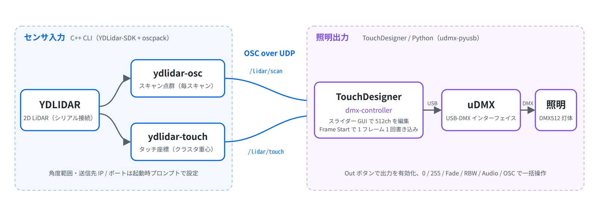

<div align="center">

# Art Project

インタラクティブアート / メディアアート制作のためのセンサ入力・照明出力ツール群

[](https://isocpp.org/)
[](https://cmake.org/)
[](https://derivative.ca/)
[](http://www.audiomulch.com/~rossb/code/oscpack/)



</div>

## 概要

Art Project は、インタラクティブアートやメディアアートの制作で繰り返し必要になる「センサ入力」と「照明出力」の道具をまとめたリポジトリです。2D LiDAR（YDLIDAR）のスキャン点群やタッチ検出結果を OSC で配信する C++ 製 CLI と、TouchDesigner から uDMX 経由で DMX 照明を操作するプロジェクトファイルを収録します。TouchDesigner をはじめ OSC を受け取れる環境と組み合わせて使うことを想定しています。

| ツール | 種別 | 役割 | OSC アドレス |
| --- | --- | --- | --- |
| [ydlidar-osc](./ydlidar-osc/README.md) | C++ CLI | YDLIDAR のスキャン点群を毎スキャン OSC 送信 | `/lidar/scan` |
| [ydlidar-touch](./ydlidar-touch/README.md) | C++ CLI | 指定距離帯の点をクラスタリングし、タッチ座標として OSC 送信 | `/lidar/touch` |
| [dmx-controller](./dmx-controller/README.md) | TouchDesigner | スライダー GUI で DMX 512ch を uDMX から出力 | — |

## 特徴

- **対話式セットアップ** — LiDAR ツールは起動時のプロンプトで角度範囲・送信先・シリアルポート・スキャン周波数を設定できる（多くの項目は `d` で既定値を採用）
- **極座標 / 直交座標の切替** — ydlidar-osc は `(角度, 距離)` と `(x, y)` のどちらで送るかを起動時に選べる
- **タッチ検出のクラスタリング** — ydlidar-touch は距離帯でフィルタした点を近傍距離でまとめ、各クラスタの重心だけを送るため受信側の処理が軽い
- **フレーム同期の DMX 出力** — dmx-controller は TouchDesigner の Frame Start で 1 フレームに 1 回だけ uDMX へ 512ch を書き込み、同一フレーム内の重複送信を抑える（フレーム番号が取れない場合は 40 Hz 上限）
- **プリセット操作** — サイドバーの `0` / `255` ボタンでスライダー群を一括設定、`Fade` / `Audio` / `OSC` は各灯体の Dim スライダーを CHOP 値で駆動、`RBW` は RGB スライダーをレインボーで回す
- **ヘッダ同梱** — oscpack と YDLidar-SDK のヘッダを `include/` に収録済みで、用意するのは静的ライブラリ 2 つだけ

## 技術スタック

| 領域 | 技術 |
| --- | --- |
| LiDAR ツール | C++14 / CMake 3.10+ / [YDLidar-SDK](https://github.com/YDLIDAR/YDLidar-SDK) / [oscpack](http://www.audiomulch.com/~rossb/code/oscpack/) |
| DMX ツール | [TouchDesigner](https://derivative.ca/) / Python / [udmx-pyusb](https://github.com/dhocker/udmx-pyusb) |
| 通信 | OSC over UDP / DMX512（uDMX） |

## セットアップ

### LiDAR ツール（ydlidar-osc / ydlidar-touch）

前提:

- CMake 3.10 以上と、シリアル接続の三角測距タイプ YDLIDAR
- `CMakeLists.txt` の指定は C++14 ですが、`utils.h` が C++17 の `if constexpr` を使うため、これを拡張として受け付けるコンパイラ（MSVC / GCC / Clang は警告付きでコンパイル）
- ルートの `CMakeLists.txt` が `lib/oscpack.lib` と `lib/ydlidar_sdk.lib` を import するため、Windows / Visual Studio 前提。他環境は未検証で、この 2 つの `IMPORTED_LOCATION` の差し替えに加え、`ydlidar-osc/src/osc.h` / `ydlidar-touch/src/osc.h` の `#include <ip\UdpSocket.h>` をスラッシュ区切りに直す書き換えが必要

YDLidar-SDK と oscpack をビルドし、静的ライブラリ `lib/oscpack.lib` と `lib/ydlidar_sdk.lib` を `lib/` に配置してからビルドする。

```bash
git clone https://github.com/Akkunlab/art-project.git
cd art-project
mkdir lib
mkdir build && cd build
cmake ..
cmake --build .
```

ビルド後に `ydlidar-osc` または `ydlidar-touch` を起動すると、以下の順でプロンプトが表示されます。

| 項目 | 既定値 / 入力 | 対象 |
| --- | --- | --- |
| Development mode | no | 共通 |
| Coordinate system（polar / cartesian） | polar | ydlidar-osc |
| Min angle / Max angle [deg] | -180 / 180 | 共通 |
| Touch detection min / max range [m] | 0.1 / 0.5 | ydlidar-touch |
| Max distance between points in a cluster [m] | 0.05 | ydlidar-touch |
| Minimum number of points in a cluster | 3 | ydlidar-touch |
| OSC target IP / port | 127.0.0.1 / 7000 | 共通 |
| LiDAR serial port | 自動検出（複数あれば番号で選択） | 共通 |
| Baudrate | 115200〜512000 から番号で選択 | 共通 |
| One-way communication | `y` を含む入力で yes、それ以外は no | 共通 |
| Scan frequency [Hz] | 5〜12 の範囲で入力 | 共通 |

Development mode から OSC target IP / port までは `d` で既定値を採用できます。LiDAR serial port 以降の 4 項目は `d` が効かず、番号または値をそのまま入力します。

送信される OSC メッセージ:

- `/lidar/scan` — 1 スキャン分の点を `angle range angle range ...`（polar、角度は rad・距離は m）または `x y x y ...`（cartesian）の float 列で送る
- `/lidar/touch` — 検出したクラスタ重心を `x y x y ...` の float 列で送る（クラスタが 0 個のときは送信しない）

### dmx-controller

前提:

- TouchDesigner（Windows）
- uDMX インターフェイス

```cmd
"C:\Program Files\Derivative\TouchDesigner\bin\python.exe" -m pip install udmx-pyusb
```

1. uDMX インターフェイスを PC に接続する
2. TouchDesigner で `dmx-controller/src/dmx_controller.toe` を開く
3. サイドバーの `Out` ボタンを押して DMX 出力を有効にする

スライダーと DMX チャンネルの対応は `dmx-controller/src/gui/slider_label_table.tsv`、サイドバーのボタン一覧は `dmx-controller/src/sidebar/button_label_table.tsv` で定義しています。

## 構成

```text
art-project/
├── CMakeLists.txt      # ydlidar-osc / ydlidar-touch を束ね、lib/ の静的ライブラリを import
├── docs/               # README 用の構成図
├── include/            # oscpack（ip/ osc/）と YDLidar-SDK（ydlidar_sdk/）のヘッダ
├── lib/                # oscpack.lib / ydlidar_sdk.lib を配置する（git 管理外）
├── ydlidar-osc/        # スキャン点群を OSC 送信する CLI
├── ydlidar-touch/      # タッチ検出のクラスタ重心を OSC 送信する CLI
└── dmx-controller/     # TouchDesigner プロジェクトと udmx / gui / sidebar の Python スクリプト
```
